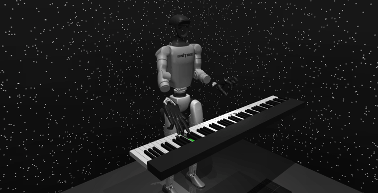
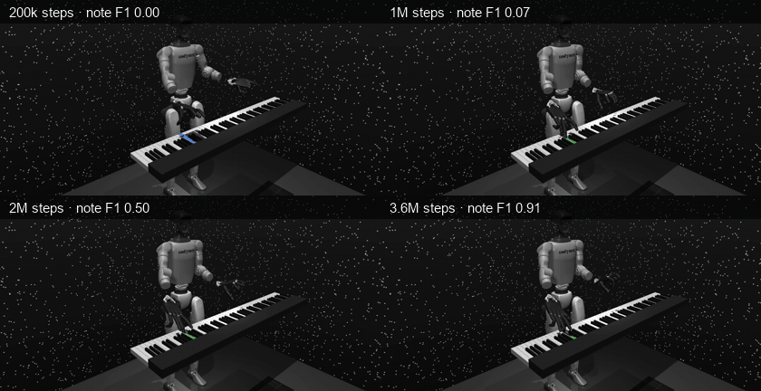
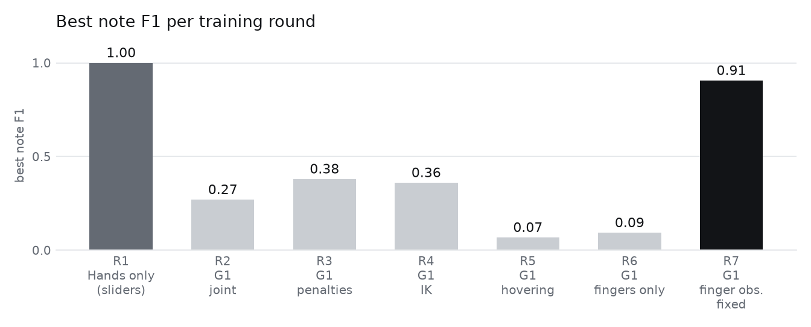
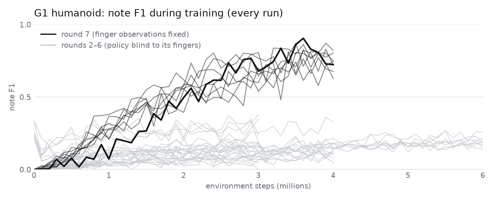
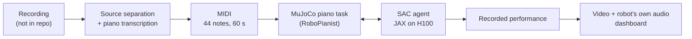
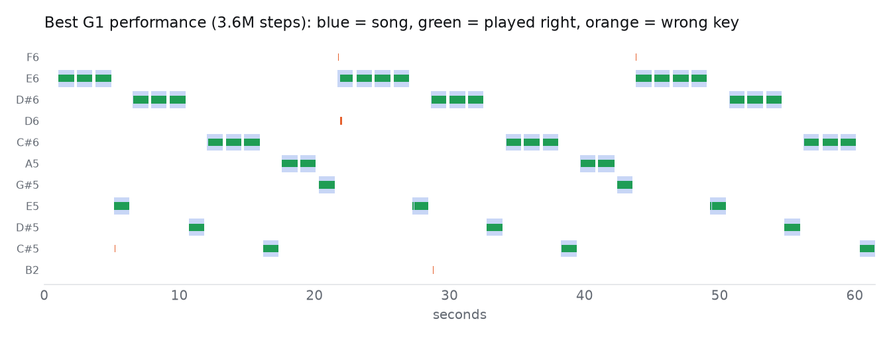

<div align="center">

# rei-piano

**A simulated Unitree G1 humanoid learns to play the opening of Kanye West's "Runaway"
with reinforcement learning.**



<sub>The best policy after 3.6M steps: 43 of 44 notes on time (note F1 0.905). MuJoCo + RoboPianist + SAC in JAX.</sub>

[](LICENSE)


</div>

---

## Results

| Phase | Who plays | Result |
|---|---|---|
| 1 | Two Shadow Hands on sliders (the RoboPianist setup) | **note F1 1.000** on 45 s, **0.989** on 60 s, after ~1M steps (~12 min on one H100) |
| 2 | The same hands on a **Unitree G1 humanoid**; the policy also drives both arms | **note F1 0.905** after 3.6M steps: 43/44 notes on time, 51 key presses for 44 notes |

<sub>**Note F1**: each note must be struck on the right key within ±100 ms, and every extra
key press counts as a mistake (1.0 = perfect). Defined [below](#measuring-it-note-f1).</sub>

The riff, one note at a time at 87 BPM:

```
E E E E · D# D# D# D# · C# C# C# C# · A A G# E          (one strike every 1.379 s)
```

## Watch it learn

The same 6 seconds of the song at four points in training (round 7, best run):

<div align="center">

</div>

At 200k steps it flails and presses random keys. By 1M the hands hover over the right
keys. By 2M you can hear the riff. By 3.6M it plays.

## The story: seven rounds, one missing observation

The two hands learned the song quickly. The humanoid did not, for five rounds:

<picture>
  <source media="(prefers-color-scheme: dark)" srcset="assets/rounds_dark.png">
  
</picture>

| Round | What changed | Best note F1 |
|---|---|---|
| 1 | Two hands on sliders (baseline) | **1.00** |
| 2 | Hands mounted on the G1; the policy drives shoulders and elbows | 0.27 |
| 3 | Penalties for extra presses, arm smoothing, warm start | 0.38 |
| 4 | Hand-position control through inverse kinematics | 0.36 |
| 5 | Piano lowered so the fingers hover above the keys | 0.07 |
| 6 | Wrist range limited so only the fingers can press keys | 0.09 |
| 7 | **Fixed a bug: the policy could not see its own fingers** | **0.91** |

In rounds 2–6 the hands were attached to the G1 with a raw MJCF attach instead of
composer's `attach()`. The physics and the finger actions worked, so nothing crashed. But
the hands were never registered as child entities, so their 2 × 21 finger joint angles
silently disappeared from the observation (1,076 numbers instead of 1,118). Every fix in
rounds 3–6 was tuning a policy that was playing piano blind. With the one-line fix, every
round-7 run learned:

<picture>
  <source media="(prefers-color-scheme: dark)" srcset="assets/curves_dark.png">
  
</picture>

**Lessons**

1. **Diff the observation and action specs of a new embodiment against the working one
   before training.** One print statement would have saved five rounds.
2. **Measure what you hear.** RoboPianist's per-step F1 scored the round-2 humanoid at
   0.876. It sounded bad, and note F1 (0.27) agreed with the ear.
3. **Test a new body with constant commands before training it.** Two cheap checks found
   that resting fingertips crept into keys and that lowering the wrist pressed 4–6 keys at
   once.

Round by round, with all the numbers: [docs/06_results.md](docs/06_results.md).

## How it works



1. **Notes.** No reliable sheet music existed, so the piano part was transcribed from the
   recording (Demucs stems, a piano transcription model, then a check of every strike
   against the full mix). Details: [docs/02](docs/02_song_transcription.md).
2. **Task.** RoboPianist turns the MIDI into a MuJoCo task: 88 spring-loaded keys, two
   Shadow Hands, and a goal for every 50 ms step. For phase 2 the hands sit on the wrists of
   a Unitree G1 (legs locked) whose shoulders and elbows the policy also controls.
3. **Learning.** Soft Actor-Critic with DroQ critics in JAX. 20 simulators per run on CPU
   cores, learning on an H100, 8 runs in parallel on one 8×H100 node.

### The task as an MDP

Playing the song is a Markov decision process. Each 50 ms the policy sees the state
$s_t$ (joint angles, key states, and the next 0.5 s of the piano roll; 1,118 numbers for
the G1) and outputs target joint positions $a_t \in [-1,1]^d$ ($d = 43$ for the G1). It
maximises the discounted return

```math
J(\pi) = \mathbb{E}_{\pi}\Big[\sum_{t=0}^{T-1} \gamma^t\, r(s_t, a_t)\Big], \qquad T = 1{,}209 \text{ steps},\ \gamma = 0.88 .
```

A small discount fits the task. The effective horizon $1/(1-\gamma) \approx 8$ steps
(0.4 s) matches the 0.5 s look-ahead and the 1.38 s gap between notes.

### The reward

Let $K_t$ be the keys that should be down at step $t$ and $q_k \in [0,1]$ how far key $k$
is pressed. The key reward pays for pressing the right keys and loses half its value if
any wrong key sounds:

```math
r^{\text{key}}_t = \tfrac12 \cdot \frac{1}{|K_t|}\sum_{k \in K_t} g\big(1 - q_k\big)
\;+\; \tfrac12 \cdot \mathbb{1}\big[\text{no key outside } K_t \text{ sounds}\big],
```

where $g$ is a tolerance function that is 1 inside a band and decays smoothly outside it.
Nobody annotated a fingering for "Runaway", so the robot finds its own with an
**optimal-transport fingering** reward (from RP1M). Every step, fingers are matched to the
target keys by solving a small assignment problem,

```math
\min_{w_{jk} \in \{0,1\}} \sum_{j,k} w_{jk}\,\lVert f_j - p_k \rVert_2
\quad \text{s.t.}\quad \sum_j w_{jk} = 1\ \ \forall k \in K_t,\qquad \sum_k w_{jk} \le 1\ \ \forall j,
```

with fingertip positions $f_j$ and key positions $p_k$. The chosen finger is then rewarded
for being close to its key. Small terms penalise energy use and forearm collisions.

### Measuring it: note F1

Per-step F1 compares the keys down with the keys wanted at every 50 ms step. It forgives
a one-step blip on a neighbouring key, which you can clearly hear. So the score that
matters here counts **onsets**. Match each target onset to at most one robot onset on the
same key within ±2 steps (100 ms); with $h$ matches,

```math
P_{\text{note}} = \frac{h}{|\text{robot onsets}|},\qquad
R_{\text{note}} = \frac{h}{|\text{target onsets}|},\qquad
F1_{\text{note}} = \frac{2\,P_{\text{note}}\,R_{\text{note}}}{P_{\text{note}} + R_{\text{note}}} .
```

The round-2 G1 hit 40 of 44 notes ($R = 0.91$) but pressed keys 253 times ($P = 0.16$):
note F1 0.27, while per-step F1 said 0.876.

<picture>
  <source media="(prefers-color-scheme: dark)" srcset="assets/pianoroll_dark.png">
  
</picture>

### The learner: Soft Actor-Critic

SAC maximises reward plus the policy's entropy, so the policy stays as random as it can
afford while it learns:

```math
J_{\text{SAC}}(\pi) = \mathbb{E}\Big[\sum_t \gamma^t \big(r_t + \alpha\,\mathcal{H}(\pi(\cdot \mid s_t))\big)\Big].
```

Two critics regress onto a soft Bellman target that uses the smaller of two slow-moving
target networks, which counters Q-value overestimation:

```math
y = r + \gamma \Big(\min_{i=1,2} Q_{\bar\phi_i}(s', a') - \alpha \log \pi_\theta(a' \mid s')\Big),\qquad a' \sim \pi_\theta(\cdot \mid s') .
```

As in RoboPianist's DroQ setup, each critic layer uses 1% dropout and LayerNorm. That is
what makes one gradient step per environment step stable.

### Hand-position control (IK)

In IK mode the policy outputs a target position for each wrist instead of four arm joint
angles. A damped least-squares solver turns that into joint angles, with a null-space pull
toward a natural home pose:

```math
\Delta q = J^\top\big(JJ^\top + \lambda^2 I\big)^{-1} e \;+\; \big(I - J^\top (JJ^\top + \lambda^2 I)^{-1} J\big)\, k\,(q_{\text{home}} - q),
```

with $\lambda = 0.05$, $k = 0.1$ and 4 iterations per control step. With 3 seeds each,
joint control and IK ended up equally good (best note F1 0.77–0.87 vs 0.75–0.91).

Every equation in the project, with its code location: [docs/07_math.md](docs/07_math.md).

## Speed and cost

| | |
|---|---|
| Hardware | one rented 8×H100 machine, 8 runs in parallel (one per GPU, 28 CPU threads each) |
| Throughput | ~1,300–1,600 environment steps/s per run |
| Hands (phase 1) | solved in ~1M steps, about 12 minutes |
| G1 (phase 2) | 4M steps in ~0.9 h per run |
| Whole project | 7 rounds, 56 runs, about **$218** of GPU time |

The fixes that mattered most were one math-library thread per simulator process (2×
faster simulation), a NumPy F1 metric instead of scikit-learn (−42% simulation time), a CPU
copy of the actor for acting, and pinning each run to its own CPU block. Details:
[docs/04_training.md](docs/04_training.md).

## Quickstart

```bash
# Python env (macOS or Linux). Needs uv, ffmpeg and fluidsynth (macOS: brew install ffmpeg fluid-synth)
uv venv -p 3.12 .venv && VIRTUAL_ENV=.venv uv pip install -e . soundfile pytest
.venv/bin/python -m pytest -q tests          # metrics, actor equivalence, G1 observations
.venv/bin/python scripts/make_midi.py        # data/midi/runaway_{45,60}s.mid
bash scripts/get_g1.sh                       # Unitree G1 model (MuJoCo Menagerie)
```

```bash
# Train the two hands (CPU works for a smoke test; use a GPU for real runs)
.venv/bin/python -m runaway.train --run-name hands --num-envs 8 --total-env-steps 20000

# Train the G1 with the round-7 settings (best run: IK + extra-press penalty)
.venv/bin/python -m runaway.train --run-name g1 --env.embodiment g1 --env.arm-control ik \
    --env.piano-height 0.70 --env.extra-press-penalty 0.5 --sac.discount 0.88 --total-env-steps 4000000

# Turn a recorded evaluation into a video with the robot's own piano audio
.venv/bin/python -m runaway.render --recording runs/g1/evals/step_004000000.npz --camera humanoid_front_left

# Build the training dashboard (curves, piano rolls, videos, replay) and open it
.venv/bin/python -m runaway.dashboard.build --runs runs --out outputs/dashboard_site
python3 -m http.server 8000 --directory outputs/dashboard_site
```

Several runs at once on a multi-GPU Linux machine (one run per GPU, plus a live dashboard):

```bash
bash scripts/setup_gpu_machine.sh
COMMON_ARGS="--num-envs 20" bash scripts/launch_runs.sh sweeps/round7_g1_obsfix.txt
```

Every round's exact settings are in [`sweeps/`](sweeps/).

## Repository map

```
src/runaway/
  song.py          the riff as data → MIDI (single source of truth for the notes)
  env.py           RoboPianist task + OT fingering reward + fast F1 metric
  humanoid.py      the G1 humanoid with Shadow Hands on its wrists (joint or IK control)
  vec_env.py       N simulators in N processes
  sac.py           SAC agent, GPU replay buffer, CPU (NumPy) actor
  train.py         training loop: async learning, checkpoints, resume, warm start
  evaluate.py      record a performance; per-step and note-level scores
  render.py        recording → video with the robot's own piano audio
  dashboard/       live + replayable training dashboard (build.py, app.html)
scripts/           MIDI, transcription, GPU machine setup, launching runs, benchmarks
sweeps/            one file per training round: run names + settings
tests/             metric, actor and observation tests
docs/              everything needed to understand and reproduce this
assets/            images for this README
```

## Docs

1. [Research notes](docs/01_research_notes.md): the papers and the decisions they led to
2. [Song transcription](docs/02_song_transcription.md): how the notes were found, with evidence
3. [Environment](docs/03_environment.md): what the robot sees, does and is rewarded for
4. [Training](docs/04_training.md): SAC, the fast training loop, all settings
5. [Results](docs/06_results.md): every training round, including the failures
6. [Math](docs/07_math.md): every equation (MDP, reward, OT fingering, F1, SAC, IK)

## Credits

[RoboPianist](https://github.com/google-research/robopianist) (Zakka et al., 2023) for the
piano, hands and task; RP1M (Zhao et al., 2024) for the optimal-transport fingering reward;
[MuJoCo Menagerie](https://github.com/google-deepmind/mujoco_menagerie) for the Shadow Hand
and Unitree G1 models; the humanoid-pianist project by anandmaj for the inspiration.

"Runaway" © Kanye West / Roc-A-Fella / Def Jam. No audio from the recording is included in
this repository.

## License

Code and docs: [MIT](LICENSE). The Runaway notes (`data/midi/`, the note data in
`src/runaway/song.py`) are a transcription of a copyrighted composition, included only to
reproduce the research and not covered by the MIT license. Third-party models (RoboPianist,
MuJoCo Menagerie Shadow Hand and Unitree G1) are downloaded separately under their own
licenses.
