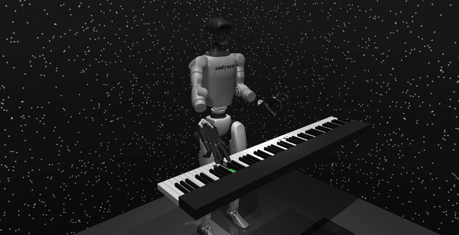
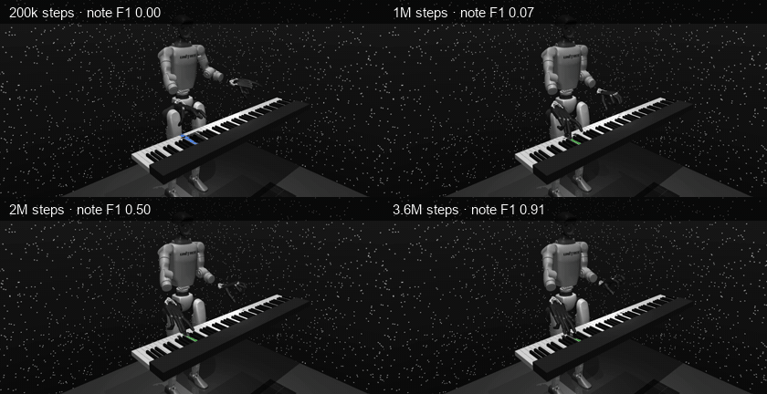
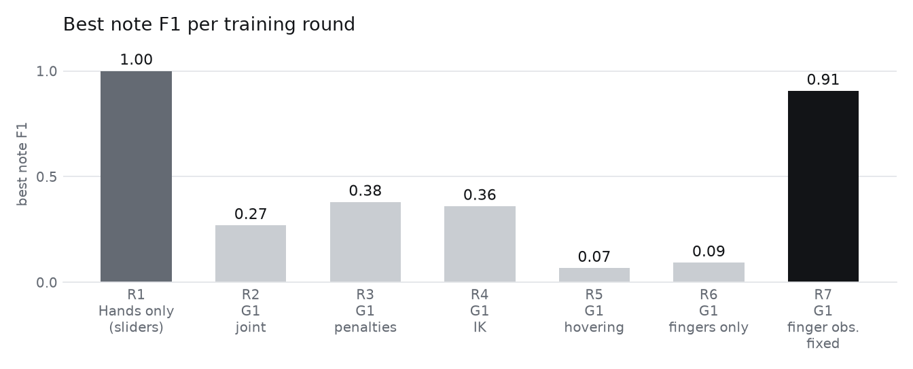
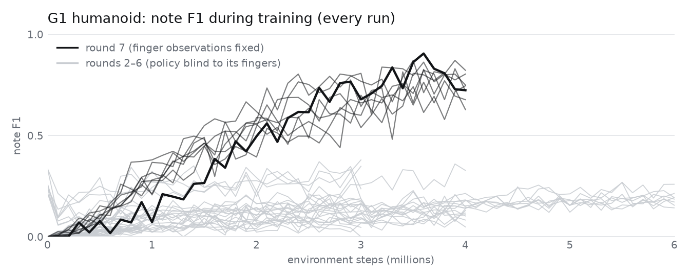
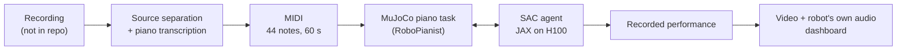
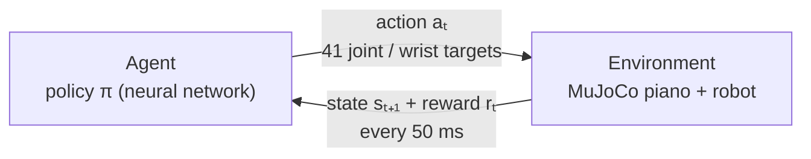
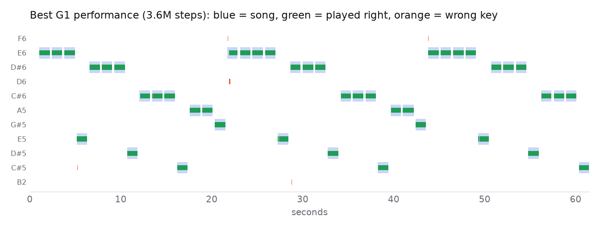
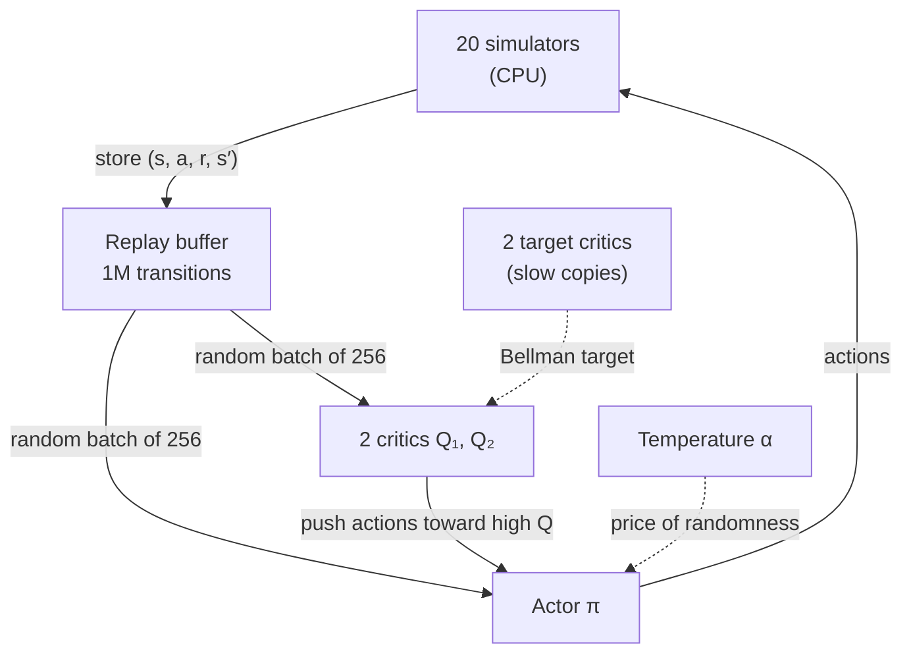

<div align="center">

# rei-piano

**A simulated Unitree G1 humanoid learns to play the opening of Kanye West's "Runaway"
with reinforcement learning.**



<sub>The best policy after 3.6M steps: 43 of 44 notes on time (note F1 0.905). MuJoCo + RoboPianist + SAC in JAX.</sub>

**[Training dashboard](https://ctxnn.github.io/rei-piano/)**: every run's curves, piano rolls and videos, with a replay of training ·
**[Trained policies](https://huggingface.co/ctxnn1/rei-piano)** on Hugging Face.

[](LICENSE)


</div>

---

## Results

| Phase | Who plays | Result |
|---|---|---|
| 1 | Two Shadow Hands on sliders (the RoboPianist setup) | **note F1 1.000** on 45 s, **0.989** on 60 s, after ~1M steps (~12 min on one H100) |
| 2 | The same hands on a **Unitree G1 humanoid**; the policy also drives both arms | **note F1 0.905** after 3.6M steps: 43/44 notes on time, 51 key presses for 44 notes |

<sub>**Note F1**: each note must be struck on the right key within ±100 ms, and every extra
key press counts as a mistake (1.0 = perfect). Defined [below](#measuring-it-note-f1).</sub>

The riff, one note at a time at 87 BPM:

```
E E E E · D# D# D# D# · C# C# C# C# · A A G# E          (one strike every 1.379 s)
```

## Watch it learn

The same 6 seconds of the song at four points in training (round 7, best run):

<div align="center">

</div>

At 200k steps it flails and presses random keys. By 1M the hands hover over the right
keys. By 2M you can hear the riff. By 3.6M it plays.

## The story: seven rounds, one missing observation

The two hands learned the song quickly. The humanoid did not, for five rounds:

<picture>
  <source media="(prefers-color-scheme: dark)" srcset="assets/rounds_dark.png">
  
</picture>

| Round | What changed | Best note F1 |
|---|---|---|
| 1 | Two hands on sliders (baseline) | **1.00** |
| 2 | Hands mounted on the G1; the policy drives shoulders and elbows | 0.27 |
| 3 | Penalties for extra presses, arm smoothing, warm start | 0.38 |
| 4 | Hand-position control through inverse kinematics | 0.36 |
| 5 | Piano lowered so the fingers hover above the keys | 0.07 |
| 6 | Wrist range limited so only the fingers can press keys | 0.09 |
| 7 | **Fixed a bug: the policy could not see its own fingers** | **0.91** |

In rounds 2–6 the hands were attached to the G1 with a raw MJCF attach instead of
composer's `attach()`. The physics and the finger actions worked, so nothing crashed. But
the hands were never registered as child entities, so their 2 × 21 finger joint angles
silently disappeared from the observation (1,076 numbers instead of 1,118). Every fix in
rounds 3–6 was tuning a policy that was playing piano blind. With the one-line fix, every
round-7 run learned:

<picture>
  <source media="(prefers-color-scheme: dark)" srcset="assets/curves_dark.png">
  
</picture>

**Lessons**

1. **Diff the observation and action specs of a new embodiment against the working one
   before training.** One print statement would have saved five rounds.
2. **Measure what you hear.** RoboPianist's per-step F1 scored the round-2 humanoid at
   0.876. It sounded bad, and note F1 (0.27) agreed with the ear.
3. **Test a new body with constant commands before training it.** Two cheap checks found
   that resting fingertips crept into keys and that lowering the wrist pressed 4–6 keys at
   once.

Round by round, with all the numbers: [docs/06_results.md](docs/06_results.md).

## How it works, step by step

> **Contents:** [1 Pipeline](#1-the-pipeline) · [2 RL in one minute](#2-reinforcement-learning-in-one-minute) · [3 The task as an MDP](#3-the-task-as-an-mdp) · [4 The reward](#4-the-reward) · [5 Measuring it](#5-measuring-it-note-f1) · [6 The learner (SAC)](#6-the-learner-soft-actor-critic) · [7 Why SAC and not PPO](#7-why-sac-and-not-ppo) · [8 The humanoid's arms (IK)](#8-the-humanoids-arms-joint-or-ik-control) · [9 The bug](#9-the-bug-that-cost-five-rounds)

### 1. The pipeline



1. **Notes.** No reliable sheet music existed, so we transcribed the piano part from the
   recording: Demucs separates the piano, a transcription model turns it into notes, and
   every strike was checked against the full mix (52 of 53 confirmed). Result: 44 notes in
   60 s, one every 1.38 s. This MIDI file is the project's only dataset. Details:
   [docs/02](docs/02_song_transcription.md).
2. **Task.** RoboPianist turns the MIDI into a MuJoCo task: 88 spring-loaded keys, two
   Shadow Hands, and a goal for every 50 ms step. For phase 2 the hands sit on the wrists of
   a Unitree G1 (legs locked) whose shoulders and elbows the policy also controls.
3. **Learning.** Soft Actor-Critic with DroQ critics in JAX. 20 simulators per run on CPU
   cores, learning on an H100, 8 runs in parallel on one 8×H100 node.

### 2. Reinforcement learning in one minute



An **agent** acts in an **environment** in a loop, 20 times per second (1,209 steps per
performance). Each step it sees a **state**, picks an **action**, and gets back a
**reward**: one number saying how good that step was. Nobody shows it the correct action;
it learns by trial and error which actions lead to reward. Its rule for choosing actions
is the **policy** $\pi(a \mid s)$.

The agent maximises the **return**, the discounted sum of future rewards:

```math
G_t = r_t + \gamma\, r_{t+1} + \gamma^2 r_{t+2} + \dots = \sum_{k \ge 0} \gamma^k\, r_{t+k}, \qquad \gamma = 0.88 .
```

Each step of delay multiplies a reward by $\gamma$. A reward 5 steps away counts
$0.88^5 \approx 0.53$; 20 steps away, $0.08$. The effective horizon
$1/(1-\gamma) \approx 8$ steps (0.4 s) matches the 0.5 s of notes the robot can see ahead.
RoboPianist found that large discounts such as 0.99 make piano agents cautious and skip notes.

Two value functions appear in every actor-critic method:

```math
V^\pi(s) = \mathbb{E}_\pi\big[G_t \mid s_t = s\big], \qquad Q^\pi(s,a) = \mathbb{E}_\pi\big[G_t \mid s_t = s,\ a_t = a\big].
```

$V$ answers "how good is this situation?"; $Q$ answers "how good is it to take *this*
action here?". $Q$ obeys the **Bellman equation**, which lets it be learned one step at a
time without waiting for the song to end:

```math
Q^\pi(s,a) = \mathbb{E}\big[r + \gamma\, Q^\pi(s', a')\big], \qquad a' \sim \pi(\cdot \mid s') .
```

*Worked example:* the critic guesses $Q(s,a) = 4.0$; we get $r = 0.8$ and it values the next
state at $5.0$. The target is $0.8 + 0.88 \times 5.0 = 5.2$, so the guess is nudged up.
In an **actor-critic** method, a *critic* network learns $Q$ this way and an *actor* network
(the policy) moves toward actions the critic rates highly.

### 3. The task as an MDP

A problem written as states, actions, dynamics, reward and discount is a **Markov decision
process**. Ours:

| Part | For the G1 humanoid |
|---|---|
| **State** $s_t$ | 1,118 numbers, broken down below |
| **Action** $a_t \in [-1,1]^d$ | 41 numbers in IK mode (43 in joint mode), broken down below |
| **Dynamics** | targets go to position servos; MuJoCo simulates 10 physics steps of 5 ms per 50 ms control step. The agent never sees these equations; it learns what its actions do by trying them |
| **Reward** $r_t$ | [step 4](#4-the-reward) |
| **Discount** $\gamma$ | 0.88 |

**What the robot sees every 50 ms: 1,118 numbers**

| Part | Count | Where the number comes from | Meaning |
|---|---:|---|---|
| Goal (piano roll) | **979** | 11 time steps × 89 (88 keys + sustain pedal) | which keys should be down now and at each of the next 10 steps (0.5 s look-ahead, like reading sheet music ahead) |
| Piano state | **89** | 88 keys + 1 pedal | how far each key is pressed (0 to 1) and the pedal state |
| Finger joint angles | **42** | 2 hands × 21 joints | where its own fingers are (the numbers missing in rounds 2–6, see [step 9](#9-the-bug-that-cost-five-rounds)) |
| Arm joint angles | **8** | 2 arms × (3 shoulder + 1 elbow) | where its arms are |
| **Total** | **1,118** | 979 + 89 + 42 + 8 | |

**What the robot outputs every 50 ms: 41 numbers (IK mode)**

| Part | Count | Where the number comes from |
|---|---:|---|
| Finger joint targets | **34** | 2 hands × 17 (RoboPianist's reduced action space) |
| Wrist position targets | **6** | 2 wrists × (x, y, z); inverse kinematics turns them into arm joint angles |
| Sustain pedal | **1** | |
| **Total** | **41** | 34 + 6 + 1. In joint mode, 8 arm joint targets replace the 6 wrist targets: 34 + 8 + 1 = **43** |

Each action number is in $[-1, 1]$ and is scaled to that joint's range. One performance is
$T = 1{,}209$ control steps (1 s lead-in + 60.4 s of music), and the policy maximises

```math
J(\pi) = \mathbb{E}_{\pi}\Big[\sum_{t=0}^{T-1} \gamma^t\, r(s_t, a_t)\Big], \qquad T = 1{,}209 \text{ steps}.
```

### 4. The reward

The reward is the only way to tell the robot what we want. At every step it is a sum of terms:

```math
r_t = r^{\text{key}}_t + r^{\text{fingering}}_t + r^{\text{energy}}_t + r^{\text{forearm}}_t \;\big(+\, r^{\text{extra press}}_t\big)
```

| Term | Pays for | Value |
|---|---|---|
| $r^{\text{key}}_t$ | the right keys down, no wrong key sounding | 0 to 1 |
| $r^{\text{fingering}}_t$ | fingertips close to the keys that should be pressed (optimal-transport matching) | 0 to 1 |
| $r^{\text{energy}}_t$ | calm motion: a small penalty on actuator power ($5 \times 10^{-3}$ × power) | ≤ 0 |
| $r^{\text{forearm}}_t$ | the two forearms not colliding | 0 or 0.5 |
| $r^{\text{extra press}}_t$ | humanoid only, optional: $-0.5$ for every key press that does not start a wanted note | ≤ 0 |

<sub>RoboPianist also adds a small sustain-pedal term (pedal in the right state; always "up" for this song).</sub>

**Key press.** Let $K_t$ be the keys that should be down at step $t$ and $q_k \in [0,1]$
how far key $k$ is pressed:

```math
r^{\text{key}}_t = \tfrac12 \cdot \frac{1}{|K_t|}\sum_{k \in K_t} g\big(1 - q_k\big)
\;+\; \tfrac12 \cdot \mathbb{1}\big[\text{no key outside } K_t \text{ sounds}\big]
```

$g$ is a tolerance function: 1 when the key is within 5% of fully pressed, then a smooth
Gaussian fall to 0.1 at an error of 0.55. The smooth slope tells the agent which direction
is better; a plain right/wrong reward would not. The second half is all or nothing: any
wrong key loses it, which stops the robot from resting its whole hand on the keyboard.

*Worked example:* two keys wanted, one fully down ($g = 1$) and one 90% down
($g \approx 0.98$): $r^{\text{key}} = 0.5 \times 0.99 + 0.5 \approx 0.99$. If a finger also
brushes a neighbouring key, the second half is lost: $\approx 0.49$.

**Fingering by optimal transport.** Nobody annotated a fingering for "Runaway", so the robot
finds its own (the idea comes from RP1M). Every step, fingertips are matched to the wanted keys by
solving a small assignment problem:

```math
\min_{w_{jk} \in \{0,1\}} \sum_{j,k} w_{jk}\,\lVert f_j - p_k \rVert_2
\quad \text{s.t.}\quad \sum_j w_{jk} = 1\ \ \forall k \in K_t,\qquad \sum_k w_{jk} \le 1\ \ \forall j,
```

with fingertip positions $f_j$ and key positions $p_k$. The Hungarian algorithm solves it
exactly in microseconds (at most 10 fingers). Each matched fingertip is then rewarded for
being close to its key (full reward within 1 cm, about 0.1 at 11 cm). Because the matching
is redone from where the hand actually is, a consistent fingering emerges on its own.

*Worked example:* wanted keys at 0 cm and 10 cm; thumb at 1 cm, index at 4 cm, ring at
11 cm. Thumb → 0 and ring → 10 costs 1 + 1 = 2 cm, cheaper than any other pairing, so
those two fingers are the ones rewarded.

### 5. Measuring it: note F1

```math
\text{precision} = \frac{\text{correct presses}}{\text{all presses}}, \qquad
\text{recall} = \frac{\text{correct presses}}{\text{all wanted notes}}, \qquad
F1 = \frac{2\,P\,R}{P + R}.
```

RoboPianist's **per-step F1** computes this at every 50 ms step and averages. A finger that
taps a wrong key for one step spoils 1 step out of 1,209, so the score barely moves, yet
every tap is an audible wrong note. Our **note F1** counts **onsets** (moments a key goes
down). Each target onset is matched to at most one robot onset on the same key within
±2 steps (100 ms); with $h$ matches,

```math
P_{\text{note}} = \frac{h}{|\text{robot onsets}|},\qquad
R_{\text{note}} = \frac{h}{|\text{target onsets}|},\qquad
F1_{\text{note}} = \frac{2\,P_{\text{note}}\,R_{\text{note}}}{P_{\text{note}} + R_{\text{note}}} .
```

The round-2 G1 hit 40 of 44 notes but pressed keys 253 times:

```math
P = \tfrac{40}{253} = 0.16, \qquad R = \tfrac{40}{44} = 0.91, \qquad F1_{\text{note}} = 0.27 \quad (\text{per-step F1 said } 0.876).
```

Note F1 matched what we heard, and we now select checkpoints with it.

<picture>
  <source media="(prefers-color-scheme: dark)" srcset="assets/pianoroll_dark.png">
  
</picture>

### 6. The learner: Soft Actor-Critic



**Objective.** SAC maximises reward *plus* the policy's entropy, so it keeps exploring
("score points, but stay as random as you can afford"):

```math
J_{\text{SAC}}(\pi) = \mathbb{E}\Big[\sum_t \gamma^t \big(r_t + \alpha\,\mathcal{H}(\pi(\cdot \mid s_t))\big)\Big],
\qquad \mathcal{H}(\pi(\cdot\mid s)) = -\,\mathbb{E}_{a\sim\pi}\big[\log \pi(a \mid s)\big].
```

**Actor: a squashed Gaussian.** For each of the 41 action dimensions the network (3 × 256)
outputs a mean $\mu$ and a spread $\sigma$; the action is sampled and squashed into $[-1, 1]$:

```math
u = \mu_\theta(s) + \sigma_\theta(s)\,\varepsilon,\quad \varepsilon \sim \mathcal{N}(0, I), \qquad a = \tanh(u)
```

```math
\log \pi(a \mid s) = \sum_i \Big[\log \mathcal{N}(u_i;\, \mu_i, \sigma_i) - \log\big(1 - \tanh^2 u_i\big)\Big]
```

Because the randomness sits in $\varepsilon$ (the *reparameterisation trick*), the action is
a smooth function of $\mu$ and $\sigma$, so the critic's gradient can flow into the actor.
At evaluation the noise is switched off: $a = \tanh(\mu)$.

**Critics.** Two critics regress onto a soft Bellman target built from the *smaller* of two
slowly updated target critics (which counters Q overestimation):

```math
y = r + \gamma \Big(\min_{i=1,2} Q_{\bar\phi_i}(s', a') - \alpha \log \pi_\theta(a' \mid s')\Big),\qquad a' \sim \pi_\theta(\cdot \mid s')
```

```math
\mathcal{L}_Q = \mathbb{E}\big[(Q_{\phi_i}(s,a) - y)^2\big],
```

and the targets follow the critics slowly: $\bar\phi \leftarrow 0.995\,\bar\phi + 0.005\,\phi$.
As in RoboPianist's DroQ setup, each critic layer uses 1% dropout and LayerNorm, which keeps
one gradient update per environment step stable.

**Actor and temperature updates.**

```math
\mathcal{L}_\pi = \mathbb{E}\Big[\alpha \log \pi(a \mid s) - \tfrac12\big(Q_1(s,a) + Q_2(s,a)\big)\Big]
```

```math
\mathcal{L}(\alpha) = \alpha\,\big(\mathcal{H}_{\text{current}} - \mathcal{H}_{\text{target}}\big),\quad \mathcal{H}_{\text{target}} = -\tfrac12 \cdot 41 .
```

The actor is pulled toward actions the critics like and pushed to stay spread out; $\alpha$
tunes itself like a thermostat (too little randomness → $\alpha$ rises, too much → it
falls), so the robot explores early and plays confidently later.

| Setting | Value |
|---|---|
| Networks | 3 × 256, GELU (actor and critics) |
| Optimiser | Adam, learning rate $3 \times 10^{-4}$, batch 256, 1 update per environment step |
| Discount, target rate | $\gamma = 0.88$, $\tau = 0.005$ |
| Replay buffer | 1,000,000 transitions; first 5,000 steps random |
| Simulators per run | 20 (~1,300–1,600 steps/s) |

### 7. Why SAC and not PPO

| | On-policy (PPO) | Off-policy (SAC, ours) |
|---|---|---|
| Learns from | only data from the current policy | any past data, from a replay buffer |
| After an update | the batch is thrown away | every sample is reused many times |
| Best when | simulation is extremely fast (thousands of robots on a GPU) | samples are expensive |

PPO limits each update by clipping the probability ratio $\rho_t = \pi_\theta(a_t \mid s_t) / \pi_{\text{old}}(a_t \mid s_t)$:

```math
L^{\text{CLIP}} = \mathbb{E}\Big[\min\big(\rho_t A_t,\ \operatorname{clip}(\rho_t,\, 1-\epsilon,\, 1+\epsilon)\, A_t\big)\Big], \qquad A_t = Q(s_t,a_t) - V(s_t),\ \ \epsilon \approx 0.2 .
```

We chose SAC because (1) our contact-rich simulator runs on CPU at ~1,500 steps/s, so
samples are expensive and must be reused; (2) the entropy bonus explores well in 41
continuous action dimensions; (3) the piano work we build on (RoboPianist, RP1M) succeeded
with this family. **We did not run PPO**; a PPO and FastTD3 comparison is planned.

### 8. The humanoid's arms: joint or IK control

On sliders, moving a hand sideways is one easy number. On the G1 the shoulders and elbows
carry the hands, and the arm amplifies errors: a 0.1 rad shoulder wobble moves the
fingertips about 40 cm × 0.1 = **4 cm**, while a key is about 2.3 cm wide.

* **Joint mode:** the policy outputs 4 joint targets per arm (3 shoulder + elbow), within ±0.4 rad of a home pose.
* **IK mode:** the policy outputs a target position for each wrist; inverse kinematics finds the joint angles.

The Jacobian $J \in \mathbb{R}^{3\times4}$ says how the wrist moves when each joint turns a
little ($\Delta x \approx J\,\Delta q$). A damped least-squares solver inverts it, with a
null-space pull toward a natural home pose:

```math
\Delta q = J^\top\big(JJ^\top + \lambda^2 I\big)^{-1} e \;+\; \big(I - J^\top (JJ^\top + \lambda^2 I)^{-1} J\big)\, k\,(q_{\text{home}} - q),
```

where $e$ is the wrist error, $\lambda = 0.05$ is the damping (keeps motion calm when the
arm is nearly straight) and $k = 0.1$; the second term only uses the spare degree of freedom
(4 joints for a 3-D target), so it never moves the wrist. 4 iterations per control step.
With 3 seeds each, joint control and IK ended up equally good (best note F1 0.77–0.87 vs
0.75–0.91).

### 9. The bug that cost five rounds

| Observation | Hands on sliders | G1, rounds 2–6 | G1, round 7 |
|---|---|---|---|
| Goal + piano | 1,068 | 1,068 | 1,068 |
| Arm / slider position | included | 8 | 8 |
| Finger joint angles | included | **missing (0 of 42)** | 42 |
| Total | 1,114 | 1,076 | 1,118 |

The hands were attached to the G1 with a raw MJCF `site.attach(...)` instead of composer's
`attach()`, so their sensors were never registered. Physics, actions and reward all worked,
and nothing crashed, but the policy was playing piano without feeling its fingers. It still
saw the keys and the goal, so it learned to poke until a key went down, which is the jitter
heard in round 2. The fix is one line, plus a regression test
([tests/test_humanoid_observations.py](tests/test_humanoid_observations.py)). Same reward,
same algorithm, same budget: every round-7 run learned (0.75–0.91).

Every equation in the project, with its code location: [docs/07_math.md](docs/07_math.md).

## Speed and cost

| | |
|---|---|
| Hardware | one rented 8×H100 machine, 8 runs in parallel (one per GPU, 28 CPU threads each) |
| Throughput | ~1,300–1,600 environment steps/s per run |
| Hands (phase 1) | solved in ~1M steps, about 12 minutes |
| G1 (phase 2) | 4M steps in ~0.9 h per run |
| Whole project | 7 rounds, 56 runs, about **$218** of GPU time |

The fixes that mattered most were one math-library thread per simulator process (2×
faster simulation), a NumPy F1 metric instead of scikit-learn (−42% simulation time), a CPU
copy of the actor for acting, and pinning each run to its own CPU block. Details:
[docs/04_training.md](docs/04_training.md).

## Quickstart

```bash
# Python env (macOS or Linux). Needs uv, ffmpeg and fluidsynth (macOS: brew install ffmpeg fluid-synth)
uv venv -p 3.12 .venv && VIRTUAL_ENV=.venv uv pip install -e . soundfile pytest
.venv/bin/python -m pytest -q tests          # metrics, actor equivalence, G1 observations
.venv/bin/python scripts/make_midi.py        # data/midi/runaway_{45,60}s.mid
bash scripts/get_g1.sh                       # Unitree G1 model (MuJoCo Menagerie)
```

```bash
# Train the two hands (CPU works for a smoke test; use a GPU for real runs)
.venv/bin/python -m runaway.train --run-name hands --num-envs 8 --total-env-steps 20000

# Train the G1 with the round-7 settings (best run: IK + extra-press penalty)
.venv/bin/python -m runaway.train --run-name g1 --env.embodiment g1 --env.arm-control ik \
    --env.piano-height 0.70 --env.extra-press-penalty 0.5 --sac.discount 0.88 --total-env-steps 4000000

# Turn a recorded evaluation into a video with the robot's own piano audio
.venv/bin/python -m runaway.render --recording runs/g1/evals/step_004000000.npz --camera humanoid_front_left

# Build the training dashboard (curves, piano rolls, videos, replay) and open it
.venv/bin/python -m runaway.dashboard.build --runs runs --out outputs/dashboard_site
python3 -m http.server 8000 --directory outputs/dashboard_site
```

Play a trained policy without training ([weights on Hugging Face](https://huggingface.co/ctxnn1/rei-piano)):

```bash
hf download ctxnn1/rei-piano --local-dir pretrained
.venv/bin/python pretrained/play_pretrained.py pretrained/g1_humanoid   # note F1 0.905
```

Several runs at once on a multi-GPU Linux machine (one run per GPU, plus a live dashboard):

```bash
bash scripts/setup_gpu_machine.sh
COMMON_ARGS="--num-envs 20" bash scripts/launch_runs.sh sweeps/round7_g1_obsfix.txt
```

Every round's exact settings are in [`sweeps/`](sweeps/).

## Repository map

```
src/runaway/
  song.py          the riff as data → MIDI (single source of truth for the notes)
  env.py           RoboPianist task + OT fingering reward + fast F1 metric
  humanoid.py      the G1 humanoid with Shadow Hands on its wrists (joint or IK control)
  vec_env.py       N simulators in N processes
  sac.py           SAC agent, GPU replay buffer, CPU (NumPy) actor
  train.py         training loop: async learning, checkpoints, resume, warm start
  evaluate.py      record a performance; per-step and note-level scores
  render.py        recording → video with the robot's own piano audio
  dashboard/       live + replayable training dashboard (build.py, app.html)
scripts/           MIDI, transcription, GPU machine setup, launching runs, benchmarks
sweeps/            one file per training round: run names + settings
tests/             metric, actor and observation tests
docs/              everything needed to understand and reproduce this
assets/            images for this README
```

## Docs

1. [Research notes](docs/01_research_notes.md): the papers and the decisions they led to
2. [Song transcription](docs/02_song_transcription.md): how the notes were found, with evidence
3. [Environment](docs/03_environment.md): what the robot sees, does and is rewarded for
4. [Training](docs/04_training.md): SAC, the fast training loop, all settings
5. [Results](docs/06_results.md): every training round, including the failures
6. [Math](docs/07_math.md): every equation (MDP, reward, OT fingering, F1, SAC, IK)

## Credits

[RoboPianist](https://github.com/google-research/robopianist) (Zakka et al., 2023) for the
piano, hands and task; RP1M (Zhao et al., 2024) for the optimal-transport fingering reward;
[MuJoCo Menagerie](https://github.com/google-deepmind/mujoco_menagerie) for the Shadow Hand
and Unitree G1 models; the humanoid-pianist project by anandmaj for the inspiration.

"Runaway" © Kanye West / Roc-A-Fella / Def Jam. No audio from the recording is included in
this repository.

## License

Code and docs: [MIT](LICENSE). The Runaway notes (`data/midi/`, the note data in
`src/runaway/song.py`) are a transcription of a copyrighted composition, included only to
reproduce the research and not covered by the MIT license. Third-party models (RoboPianist,
MuJoCo Menagerie Shadow Hand and Unitree G1) are downloaded separately under their own
licenses.
